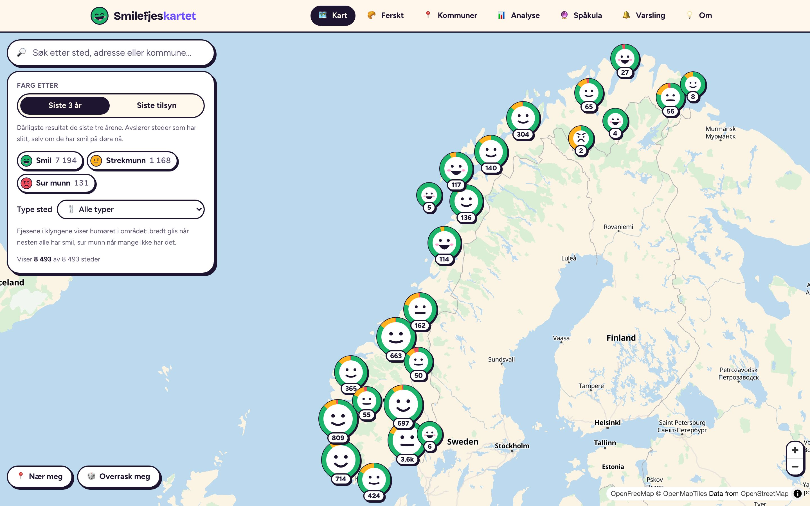
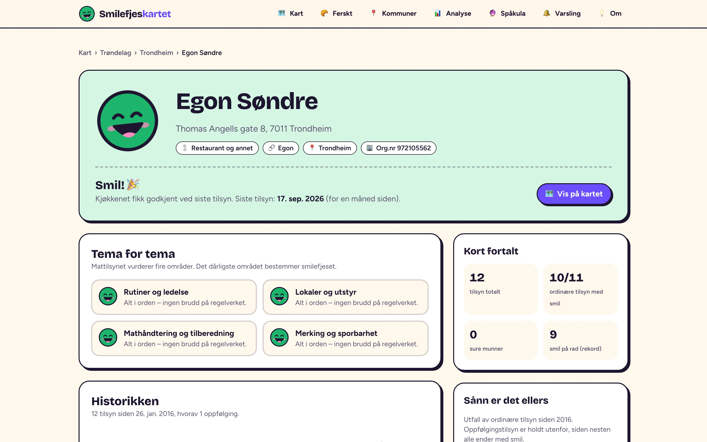
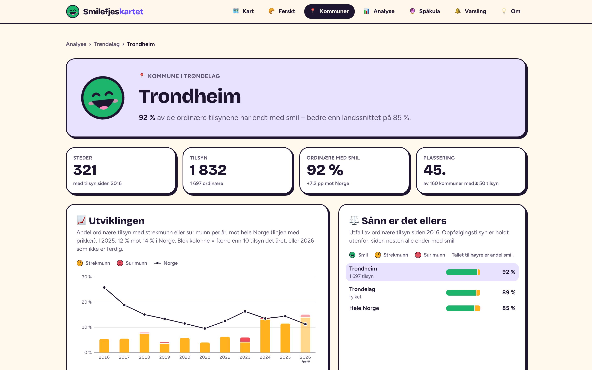

# Smilefjeskartet

**[smilefjeskartet.no](https://smilefjeskartet.no)** viser alle Mattilsynets smilefjestilsyn på ett kart, med historikken for hvert serveringssted og statistikk for kommuner, fylker og kjeder. Over 45 000 tilsyn hos rundt 8 700 steder siden 2016, oppdatert hver morgen.



## Hva du finner

- **Kartet.** Klyngene viser humøret i området, med bredt glis når nesten alle har smil og sur munn når mange ikke har det. Stedene kan farges etter siste tilsyn eller etter dårligste resultat de siste tre årene, som viser hvem som har slitt selv om det henger smil på døra nå. Søk på sted, adresse eller kommune, eller trykk «Nær meg».
- **En side per sted.** Karakter per tema, alle tilsyn siden 2016 og et smilefjesmerke stedet kan vise på sin egen nettside.
- **Kommuner, fylker og kjeder.** Utviklingen år for år, sammenlignet med fylket og hele landet.
- **Analyse.** Hva som oftest går galt, sesongvariasjon, typer steder og kjeder.
- **Ferskt.** De nyeste tilsynene, også som RSS.
- **Spåkula.** To logistiske regresjonsmodeller anslår hvilke steder som får besøk av Mattilsynet de neste 60 dagene, og sjansen for strekmunn eller sur munn ved neste tilsyn. Modellene trenes på nytt hver dag og måles mot en enkel tommelfingerregel. Kjøringen 26. oktober 2026 ga AUC 0,81 mot 0,75 for besøk og 0,72 mot 0,67 for utfall.

| Stedside | Kommuneside |
| --- | --- |
|  |  |


Tjenesten er uoffisiell og ikke tilknyttet Mattilsynet.

## Slik er det laget

- **Next.js 16, React og TypeScript, driftet på Vercel.** Hvert sted, hver kommune, hvert fylke og hver kjede har sin egen side med egen tittel og plass i sitemapen, i alt over 9 000 sider. Stedsidene har eget delingsbilde.
- **MapLibre GL med vektorfliser fra OpenFreeMap.** Kartet trenger ingen API-nøkkel. Klyngene tegnes som smilefjes med en ring som viser fordelingen av karakterer.
- **Daglig datajobb i GitHub Actions.** Jobben laster ned Mattilsynets CSV, finner kommune og fylke fra postnummeret og slår opp koordinater i Kartverkets adresse-API. Koordinatene caches mellom kjøringene, så bare nye adresser slås opp. Hvis kommuneregisteret er ugyldig, stopper jobben før de gamle datafilene overskrives.
- **Bare ordinære tilsyn i statistikken.** Oppfølgingstilsyn ender nesten alltid med smil og ville trukket tallene opp.
- **Tester.** Vitest dekker databygging, analyse, modellene og SEO. Playwright-tester kjører mot et produksjonsbygg og sjekker at kartklyngene tegnes og følger kartet når det dras.

## Kom i gang

Bruk Node.js 22, som i GitHub Actions:

```sh
npm ci
npm run dev
```

Åpne [localhost:3000](http://localhost:3000). De genererte datafilene er sjekket inn, så kart, analyse og Spåkula fungerer uten API-nøkler. Grunnkartet krever tilgang til OpenFreeMap. Next.js laster ned Google-fontene under bygging.

```sh
npm test
npm run lint
npm audit --omit=dev
npx tsc --noEmit
npm run build
npm start
```

Kartets nettlesertester kjøres mot et produksjonsbygg og bruker den ekte MapLibre-workeren. De sjekker at klynger tegnes og følger kartposisjonen under dragging:

```sh
npx playwright install chromium
npm run build
npm run test:e2e
```

CI kjører tester, lint, typesjekk, produksjonsaudit, produksjonsbygg og kartets nettlesertester for pull requests og endringer på main. Redis installeres i CI slik at lagringstestene kjører de ekte Lua-skriptene. Lokalt kan de kjøres med `VARSLING_TEST_REDIS=1 npm test` når `redis-server` og `redis-cli` er installert. Lokale arbeidskopier i `.claude/` holdes utenfor lint og typesjekk.

## Oppdatere data

Kjør i denne rekkefølgen:

```sh
npm run build:data
npm run build:prediksjon
```

`build:data` laster ned Mattilsynets CSV, slår opp kommune/fylke med Brings postnummerregister og geokoder adresser med Kartverket. Første kjøring kan ta tid; koordinater lagres i den lokale cachen `data/geocode-cache.json`. Ugyldig eller utilgjengelig kommuneregister stopper jobben før eksisterende datafiler overskrives.

- `generated/steder.json`: steder og full tilsynshistorikk, leses på serveren.
- `public/data/kart.json`: kompakt kartdata til nettleseren.
- `generated/prediksjon.json`: modellrapporter og anslag fra `build:prediksjon`, samt `fasit`, publiserte spådommer lest tilbake fra git-historikken og sjekket mot det som skjedde siden. Dette trenger full git-historikk, som arbeidsflyten henter med `fetch-depth: 0`.
- `public/tilsyn.geojson`, `public/tilsyn-diff.json`, `public/tilsyn-meta.json`: beholdte dataformater for bakoverkompatibilitet.

Workflowen [Update tilsyndata](.github/workflows/update-tilsyndata.yml) kjører hver dag kl. 06:00 UTC og kan startes manuelt. Den publiserer oppdaterte tilsynsdata selv om modelltreningen feiler; Spåkula viser datoen for datagrunnlaget slik at eldre anslag kan gjenkjennes.

## E-postvarsling

Se [oppsett og drift av varsling](docs/varsling.md) for Upstash Redis, Resend, domeneverifisering og miljøvariabler i Vercel/GitHub. Funksjonen er av uten konfigurasjon; resten av nettstedet fungerer som vanlig.

For lokal testing brukes `.env.local` med variablene i veiledningen og `NEXT_PUBLIC_SITE_URL=http://localhost:3000`. Bruk egen testdatabase og testavsender.

```sh
npm run varsling:admin -- forhandsvis
npm run varsling:admin -- status
npm run send:varsler
```

`forhandsvis` lager e-posteksempler uten sending eller API-nøkler. `status` krever konfigurasjon. `send:varsler` kan sende ekte e-post når nøklene er satt; første kjøring registrerer eksisterende tilsyn uten å sende gamle resultater.

## Hvor koden ligger

- `app/` og `components/`: Next.js-ruter og brukergrensesnitt.
- `lib/kart.ts`: søk, filtre, kartdata og URL-tilstand.
- `lib/analyse.ts` og `lib/server/omrader.ts`: analyse, aggregering og områder.
- `lib/prediksjon/`: modelltrening, tidsserier og evaluering.
- `lib/varsling/`: abonnementer, e-post og utsending.
- `scripts/`: databygging og driftskommandoer.
- `__tests__/`: Vitest-regresjonstester.

Analysen sammenligner ordinære tilsyn og holder oppfølging utenfor, fordi resultatene etter oppfølging ellers gjør sammenligningen misvisende. Kategori og kjede gjettes fra stedsnavn; kommune utledes fra postnummer. Se [Om tjenesten](https://smilefjeskartet.no/om) og forklaringene på analysen for begrensninger i datagrunnlaget.

## Data og lisens

Tilsynsdataene er fra Mattilsynet under NLOD 2.0. Koordinatene er fra Kartverkets adresse-API, og postnummerregisteret er fra Bring. Bakgrunnskartet er fra OpenFreeMap med data fra OpenStreetMap.
